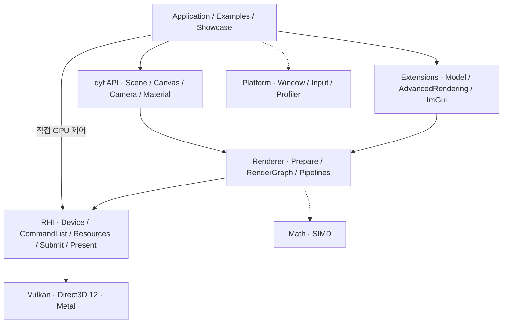

<h1 align="center">dy_framework</h1>

<p align="center">
  <strong>쉽게 쓰고, 깊게 제어하는 렌더링 프레임워크</strong><br>
  데이터 지향 설계와 명시적 GPU 제어를 위한 C++ 프레임워크<br>
  <strong>동양미래대학교 컴퓨터소프트웨어공학과 · DyD 팀 작품</strong>
</p>

<p align="center">
  <a href="https://github.com/dyd-dev/dy_engine/actions/workflows/ci.yml"></a>
  
  
  
</p>

<p align="center">
  <a href="https://dyd-dev.github.io/dy_engine/index.html">문서</a> ·
  <a href="#빠른-시작">빠른 시작</a> ·
  <a href="#쇼케이스">쇼케이스</a> ·
  <a href="#구조">구조</a> ·
  <a href=".github/assets/dy-framework.pptx">발표자료</a> ·
  <a href="#제작진">제작진</a>
</p>


<p align="center"><sub>Emerald Square · dy_framework 실제 렌더링 화면 · 원본 에셋 출처는 <a href="#라이선스와-크레딧">크레딧</a> 참고</sub></p>

## 소개

**dy_framework(`dyf`)는 동양미래대학교 컴퓨터소프트웨어공학과 DyD 팀이 제작한 렌더링 프레임워크입니다.** 저장소와 CMake 라이브러리 타깃의 이름은 `dy_engine`입니다.

Vulkan, Direct3D 12, Metal에서는 애플리케이션이 자원 상태와 동기화, GPU 명령 기록을 직접 관리합니다. dy_framework는 이 제어권을 공통 RHI(Rendering Hardware Interface)로 제공하고, 그 위에 장면·재질·조명·2D 그리기를 위한 API를 구성했습니다.

기본 렌더러로 화면을 만들고, 필요한 효과를 확장 모듈로 연결하며, 직접 GPU 작업을 구성할 때는 RHI를 사용할 수 있습니다. 장면 데이터와 GPU 자원 소유를 분리하고, 데이터 지향 처리와 SIMD, 병렬 명령 기록을 설계에 반영했습니다.

## 주요 기능

| 영역 | 제공 기능 |
| --- | --- |
| **공통 그래픽 API** | Vulkan·Direct3D 12·Metal 백엔드, 버퍼·텍스처·파이프라인·명령 목록·제출 제어 |
| **2D·3D 렌더링** | Canvas 도형·이미지·텍스트, Scene·Camera·Mesh·Material 기반 장면 구성 |
| **재질과 조명** | PBR 재질, 방향광·점광원·스폿 광원, 그림자, 환경광·반사 프로브, LTC 면광원 |
| **고급 렌더링** | SSAO·SSGI·SSR, TAA, Bloom, 볼륨 안개, 투명·굴절, HDR 후처리 |
| **대규모 장면 처리** | 인스턴싱·배칭, 메시 LOD, GPU 프러스텀·Hi-Z 컬링, indirect draw |
| **모델과 애니메이션** | glTF/GLB·FBX·OBJ 로딩, 골격 애니메이션과 GPU 스키닝 |
| **프레임 구성** | RenderGraph의 패스 의존성·자원 배리어 처리, 명령 병렬 기록 |
| **수학과 진단** | x86·ARM SIMD 수학 경로, 프로파일러 오버레이, Tracy·RenderDoc 연동 |

고급 효과와 모델 로딩, ImGui는 선택 확장으로 제공합니다. 기능별 요구 조건은 [모듈과 API 계층](https://dyd-dev.github.io/dy_engine/component/modules.html)을 참고하세요. GPU 기능은 장치의 지원 여부와 한도에 따라 달라집니다.

## 지원 플랫폼

| 플랫폼 | 그래픽 백엔드 | 창·앱 구성 | CI 빌드 구성 |
| --- | --- | --- | --- |
| Windows | Vulkan / Direct3D 12 | GLFW | 각 백엔드 Debug·Release |
| Linux | Vulkan | GLFW · X11 / Wayland | Debug·Release |
| macOS | Metal | GLFW · AppKit | Debug·Release |
| Android | Vulkan | 네이티브 앱 · Android NDK | Debug·Release, arm64-v8a·x86_64 |
| iOS | Metal | 네이티브 앱 · UIKit | Debug·Release, 기기·시뮬레이터 arm64, 서명 제외 |

백엔드는 **빌드 시 선택**합니다. Windows에서는 `USE_VULKAN` 또는 `USE_D3D12` 중 하나를 켜며, 둘 다 끄면 실제 화면을 렌더링하지 않는 Null 백엔드를 사용합니다. Linux·Android는 Vulkan, macOS·iOS는 Metal을 자동 선택합니다.

CI는 컴파일과 패키징을 확인합니다. 모든 기기의 실행 결과나 성능을 보장하는 검증은 아닙니다. 자세한 범위는 [CI 안내](.github/ci/README.md)에서 확인할 수 있습니다.

## 쇼케이스


*Bistro Exterior — 외부 모델의 재질과 환경 조명을 dy_framework의 렌더링 경로로 구성한 화면입니다.*

| 장면 | 시연 내용 |
| --- | --- |
| **Bistro Exterior / Night** | 외부 공간의 재질·환경광·그림자, 야간 광원과 후처리 |
| **Bistro Interior / Wine** | 실내 조명·반사 프로브, 유리의 투명·굴절·흡수 |
| **Emerald Square** | 건물과 식생으로 구성된 대규모 장면, LOD·컬링·와이어프레임 |
| **Arena** | 골격 애니메이션, 반복 객체의 인스턴싱과 배칭 |
| **Culling** | 공유 메시 장면에서 GPU 가시성 처리와 LOD 비교 |

`ShowcasePresentation`은 Bistro Exterior → Bistro Interior → Emerald Square를 같은 창에서 연속 시연합니다. 장면마다 기능을 켜고 끄며 결과를 비교할 수 있습니다.

- [프로젝트 발표자료 · PPTX](.github/assets/dy-framework.pptx)
- [연속 시연과 조작 방법](showcase/cinematic/Presentation.md)
- [장면별 설명과 측정 조건](showcase/Presentation.md)

## 구조



`Scene`과 `Canvas`는 CPU 입력 데이터를 보관하고, `Renderer`는 렌더링에 필요한 GPU 자원을 관리합니다. RHI를 직접 사용하는 앱은 자원 생성부터 명령 기록·제출·표시까지 직접 구성합니다. `RenderGraph`는 선언된 패스의 의존성과 배리어를 계산합니다.

| 경로 | 역할 |
| --- | --- |
| [`src/Public/`](src/Public/) | 사용자에게 노출하는 `dyf`, RHI, Math, Platform, 확장 헤더 |
| [`src/dyf/`](src/dyf/) | 장면 처리, 렌더러, 조명·그림자·GPU 가시성 처리 |
| [`src/RHI/`](src/RHI/) | 공통 그래픽 인터페이스 구현, RenderGraph, 명령 처리 |
| [`src/Backends/`](src/Backends/) | Vulkan·D3D12·Metal·Null 구현 |
| [`src/Platform/`](src/Platform/) | 창, 입력, 시간, 프로파일러 |
| [`src/Extends/`](src/Extends/) | Model·AdvancedRendering·ImGui·Tracy·RenderDoc |
| [`examples/`](examples/) · [`showcase/`](showcase/) | API 학습용 예제와 발표용 장면 |
| [`android/`](android/) · [`ios/`](ios/) | 모바일 앱 프로젝트 |
| [`docs/`](docs/) · [`tests/`](tests/) | API 문서와 회귀·계약 테스트 |

## 빠른 시작

### 준비물

- Git, **CMake 3.20 이상**, C++17 지원 컴파일러. Showcase에는 C++20 지원이 필요합니다.
- 선택한 그래픽 백엔드를 지원하는 GPU·드라이버와 아래 개발 도구.
- 첫 CMake 구성 시 외부 의존성을 내려받을 수 있는 네트워크 환경.

| 환경 | 추가 개발 도구 |
| --- | --- |
| Windows / Vulkan | Visual Studio C++ 빌드 도구, Windows SDK, Vulkan SDK의 `glslc` |
| Windows / Direct3D 12 | Visual Studio C++ 빌드 도구, Windows SDK, `dxc` |
| Linux / Vulkan | GCC 또는 Clang, Vulkan 개발 라이브러리·`glslc`, X11 또는 Wayland 개발 패키지 |
| macOS / Metal | Xcode와 `xcrun`으로 실행할 수 있는 `metal`·`metallib` |
| Android / iOS | [Android 프로젝트](android/)의 SDK·NDK 설정 / [iOS 프로젝트](ios/)와 Xcode |

### 첫 예제 실행

```sh
git clone https://github.com/dyd-dev/dy_engine.git
cd dy_engine
```

**Windows · Vulkan · Visual Studio 2022**

```powershell
cmake -S . -B build/vulkan -G "Visual Studio 17 2022" -A x64 -DUSE_VULKAN=ON -DDY_BUILD_EXAMPLES=ON -DDY_BUILD_SHOWCASE=OFF
cmake --build build/vulkan --config Release --target DyfPrimitives
.\build\vulkan\examples\dyf\01_Primitives\Release\DyfPrimitives.exe
```

Direct3D 12로 빌드하려면 별도 폴더 `build/d3d12`를 사용하고 `-DUSE_VULKAN=ON`을 `-DUSE_D3D12=ON`으로 바꿉니다. 설치한 Visual Studio 버전에 따라 `-G` 값도 맞춰 주세요.

**Linux · Vulkan / macOS · Metal · Ninja**

Ninja를 설치한 환경에서 실행합니다. 백엔드는 플랫폼에 맞게 자동 선택됩니다.

```sh
cmake -S . -B build/desktop -G Ninja -DCMAKE_BUILD_TYPE=Release -DDY_BUILD_EXAMPLES=ON -DDY_BUILD_SHOWCASE=OFF
cmake --build build/desktop --target DyfPrimitives
./build/desktop/examples/dyf/01_Primitives/DyfPrimitives
```

위 구성은 외부 장면 에셋이 필요 없는 기본 도형 예제로 시작합니다. `DY_BUILD_SHOWCASE=OFF`를 명시해 대용량 시연 에셋 준비를 제외했습니다. 모델·조명·ImGui 예제는 해당 확장을 추가로 켜야 합니다.

### 쇼케이스 실행

Windows Vulkan 구성 예시입니다. `DY_ASSET_ROOT`는 다운로드할 에셋의 위치이며, 기본 프리셋에서 필요한 원본 파일이 없으면 CMake 구성 중 다운로드·압축 해제를 수행합니다. 첫 구성에는 추가 시간과 저장 공간이 필요합니다.

```powershell
cmake -S . -B build/showcase-vulkan -G "Visual Studio 17 2022" -A x64 -DUSE_VULKAN=ON -DDY_BUILD_SHOWCASE=ON -DDY_ASSET_ROOT="C:/dy-assets"
cmake --build build/showcase-vulkan --config Release --target ShowcaseCinematic ShowcasePresentation
.\build\showcase-vulkan\showcase\Release\showcase.exe emerald --profile desktop
.\build\showcase-vulkan\showcase\Release\presentation.exe
```

두 실행 명령은 각각 단일 장면과 연속 시연을 엽니다. `emerald` 대신 `exterior`, `night`, `interior`를 선택할 수 있습니다. 에셋별 이용 조건은 [크레딧](#라이선스와-크레딧)을 확인하세요.

### 내 프로젝트에 연결

기존 CMake 프로젝트에 소스를 포함하고 필요한 타깃을 링크합니다. `app`은 사용자가 정의한 실행 파일 타깃입니다. Windows의 백엔드 옵션은 CMake 구성 시 지정합니다.

```cmake
add_subdirectory(external/dy_engine)
target_link_libraries(app PRIVATE dy_engine)
```

기본 API는 `<dyf.h>`, 저수준 API는 `<dyf/RHI.h>`로 시작합니다. 모델 로딩에는 `dyf::Model`, 고급 렌더링에는 `dyf::AdvancedRendering`을 추가로 링크합니다. 고급 렌더링 모듈은 `Renderer::AddExtension`으로 등록합니다.

완전한 Canvas 앱은 [빠른 시작 예제](https://dyd-dev.github.io/dy_engine/component/quickstart.html), 자원 수명과 명령 제출은 [RHI 가이드](https://dyd-dev.github.io/dy_engine/component/rhi-lifecycle.html)를 참고하세요.

## CMake 옵션

아래는 엔진 루트를 새 빌드 폴더에 구성할 때의 기본값입니다. 기존 빌드 폴더는 캐시 값을 유지하므로 백엔드를 바꿀 때는 폴더를 분리합니다.

<details>
<summary><strong>백엔드·확장·진단 옵션 펼치기</strong></summary>

| 옵션 | 기본값 | 설명 |
| --- | --- | --- |
| `USE_VULKAN` | Windows: `OFF` | Windows에서 Vulkan 선택. Linux·Android에서는 자동 활성화 |
| `USE_D3D12` | Windows: `OFF` | Windows에서 Direct3D 12 선택. Vulkan과 동시 선택 불가 |
| `USE_METAL` | Apple: `ON` | macOS·iOS에서 자동 선택 |
| `DY_BUILD_EXAMPLES` | `OFF` | 최상위 빌드에서 단독 예제 타깃 추가 |
| `DY_BUILD_SHOWCASE` | `DY_BUILD_EXAMPLES` 값 | 발표용 장면과 에셋 준비, Model·AdvancedRendering 자동 활성화 |
| `DY_EXTEND_MODEL` | `OFF` | 모델 로딩·애니메이션 확장 |
| `DY_EXTEND_ADVANCED_RENDERING` | `OFF` | 고급 조명·안개·투명·후처리 확장 |
| `DY_EXTEND_IMGUI` | `OFF` | 데스크톱 Dear ImGui 확장 |
| `DY_ENABLE_SIMD` | `ON` | 지원 CPU에서 SIMD 수학 경로 사용 |
| `DY_ENABLE_TRACY` | `ON` | Tracy 계측과 연결 어댑터 |
| `DY_ENABLE_LIVE_PROFILING` | `OFF` | 실행 진단 수집 |
| `DY_ENABLE_RENDERDOC` | `OFF` | RenderDoc 캡처 연동. Metal에서는 사용 불가 |
| `DY_BUILD_CONFORMANCE_TESTS` | `OFF` | 회귀·계약 검사 타깃과 CTest 등록 |
| `DY_ENABLE_SHADER_COMPILER` | `OFF` | Vulkan용 선택적 GLSL 컴파일러 내장. CMake 3.27 이상 필요 |
| `DY_LINUX_WINDOW_SYSTEM` | `AUTO` | Linux 창 시스템: `AUTO`·`X11`·`WAYLAND` |

세부 설정은 [Engine_Options.cmake](cmake/Engine_Options.cmake), 셰이더 컴파일러 옵션은 [CMakeLists.txt](CMakeLists.txt)를 기준으로 합니다.

</details>

## 문서와 예제

| 목적 | 자료 |
| --- | --- |
| 개발 환경 준비 | [시작하기](https://dyd-dev.github.io/dy_engine/component/getting-started.html) |
| 첫 화면 만들기 | [Canvas 앱 빠른 시작](https://dyd-dev.github.io/dy_engine/component/quickstart.html) |
| API 찾기 | [API 레퍼런스](https://dyd-dev.github.io/dy_engine/component/api-index.html) |
| 계층·확장 이해하기 | [모듈과 API 계층](https://dyd-dev.github.io/dy_engine/component/modules.html) |
| GPU 직접 제어 | [RHI 프레임과 자원 수명](https://dyd-dev.github.io/dy_engine/component/rhi-lifecycle.html) |
| 단계별 실습 | [dyf 예제](examples/dyf/) · [RHI 예제](examples/RHI/) · [고급 예제](examples/advanced/) |
| 프로젝트 소개 | [발표자료](.github/assets/dy-framework.pptx) · [쇼케이스 안내](showcase/Presentation.md) |
| 문제 제보·개선 제안 | [GitHub Issues](https://github.com/dyd-dev/dy_engine/issues) |

## 제작진

**동양미래대학교 컴퓨터소프트웨어공학과**<br>
**DyD — Direct, Yield, Dynamic media**

| 제작자 | 담당 | GitHub · 공개 연락처 |
| --- | --- | --- |
| **한재승** | Core/RHI | [suhanjin17](https://github.com/suhanjin17) |
| **윤훈** | Vulkan | [yunhoon0206](https://github.com/yunhoon0206) |
| **정준혁** | Metal | [Wnsgur7318](https://github.com/Wnsgur7318) |
| **정현진** | DirectX12 | [junghj0724](https://github.com/junghj0724) |

## 라이선스와 크레딧

현재 저장소 루트에는 프레임워크 자체의 라이선스 파일이 포함되어 있지 않습니다. 외부 라이브러리와 시연 에셋에는 각각의 라이선스가 적용됩니다.

GLFW, stb, bcdec, meshoptimizer, fastgltf, ufbx, Dear ImGui, Tracy 등 외부 프로젝트를 사용합니다. 의존성 버전과 원본은 [의존성 설정](cmake/Dependencies.cmake) 및 각 [확장 모듈](src/Extends/)의 CMake 설정에서 확인할 수 있습니다.

README 이미지는 발표 영상 제작에 사용한 실제 렌더링 캡처를 재사용했습니다. 원본 장면을 프레임워크에서 불러와 좌표계·크기를 맞추고 자체 재질·조명·후처리 경로로 렌더링한 결과입니다.

| 이미지·에셋 | 원저작자와 출처 | 원본 이용 조건 |
| --- | --- | --- |
| `emerald-square.png` · NVIDIA Emerald Square | Nicholas Hull, Kate Anderson, Nir Benty · [NVIDIA ORCA](https://developer.nvidia.com/orca/nvidia-emerald-square), 식생: SpeedTree | CC BY-NC-SA 3.0 |
| `bistro.png` · Amazon Lumberyard Bistro | Amazon Lumberyard · [NVIDIA ORCA](https://developer.nvidia.com/orca/amazon-lumberyard-bistro) | CC BY 4.0 |

추가 에셋과 변환 내역은 [Cinematic 크레딧](showcase/cinematic/ASSET_CREDITS.md), [Arena 크레딧](showcase/arena/ASSET_CREDITS.md), [LTC 표 라이선스](src/Extends/AdvancedRendering/Assets/ltc/LICENSE)를 참고하세요.
